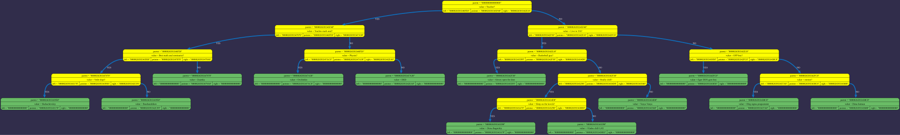

# New log, start to read the file:
Create left kid of <**Teacher?**>: <**Teaches math anal?**>

Create left kid of <**Teaches math anal?**>: <**Best math anal seminarist?**>

Create left kid of <**Best math anal seminarist?**>: <**Barabanshikov**>

Create right kid of <**Best math anal seminarist?**>: <**Znamka**>

Create right kid of <**Teaches math anal?**>: <**Physist?**>

Create left kid of <**Physist?**>: <**Ovchinkin**>

Create right kid of <**Physist?**>: <**DED**>

Create right kid of <**Teacher?**>: <**Live in 316?**>

Create left kid of <**Live in 316?**>: <**Basketball guy?**>

Create left kid of <**Basketball guy?**>: <**Alexey open the door**>

Create right kid of <**Basketball guy?**>: <**Really chill?**>

Create left kid of <**Really chill?**>: <**Sleep on the kovrik?**>

Create left kid of <**Sleep on the kovrik?**>: <**Dima Bagatskiy**>

Create right kid of <**Sleep on the kovrik?**>: <**Vlados chill GAY**>

Create right kid of <**Really chill?**>: <**Vanya Vanya**>

Create right kid of <**Live in 316?**>: <**OFP boy?**>

Create left kid of <**OFP boy?**>: <**Egor DDX gym boy**>

Create right kid of <**OFP boy?**>: <**Dima batman**>

-----------------------------------------

Add new elem: <**Skubachevskiy**>, neighbour of <**Barabanshikov**>, but <**Skubachevskiy**>: <**Vedet dopi**>

## Visualization of tree:

Add new elem: <**Oleg sigma programmer**>, neighbour of <**Dima batman**>, but <**Oleg sigma programmer**>: <**mentor**>

## Visualization of tree:

